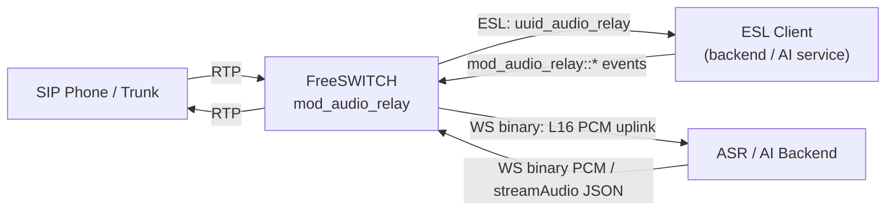

<p align="right">
  <a href="README.md">English</a> | <a href="README_ZH.md">简体中文</a>
</p>

<h1 align="center">mod_audio_relay</h1>

<p align="center">
  <strong>FreeSWITCH Audio WebSocket Relay Module — self-developed in Rust</strong>
</p>

<p align="center">
  <a href="https://www.rust-lang.org"></a>
  <a href="LICENSE"></a>
  <a href="https://github.com/tangyu-dch/mod_audio_relay"></a>
</p>

---

**mod_audio_relay** bridges a FreeSWITCH call's bidirectional audio to a
remote **WebSocket** endpoint, enabling real-time ASR, TTS injection, call
recording pipelines, and AI voice agents — all without touching the SIP
signaling path.

> [!NOTE]
> This is a **self-developed** Rust implementation. It exposes its own
> naming (`mod_audio_relay` / `uuid_audio_relay` / `mod_audio_relay::*`)
> and is API-compatible in spirit with the C reference module but is not
> drop-in source-compatible.

---

## 📋 Table of Contents

- [Features](#-features)
- [Architecture](#-architecture)
- [Quick Start](#-quick-start)
- [API Reference](#-api-reference)
- [Documentation](#-documentation)
- [Known Limitations](#-known-limitations)
- [Testing](#-testing)
- [License](#-license)

---

## ✨ Features

### 🔊 Bidirectional Audio Bridge
- **Uplink**: call audio → L16 PCM s16le WebSocket binary frames at the
  configured sample rate (8–64 kHz).
- **Downlink**: two paths — raw PCM binary frames, or `streamAudio` JSON
  messages supporting `raw` PCM and encoded formats (`wav`/`mp3`/`ogg`/
  `pcmu`/`pcma`/`opus`) decoded through FreeSWITCH's own codec stack.
- **Playback queue**: ~2 s ring buffer with generation-guarded
  `interrupt` / `stop_playback`; overflow drops oldest data.

### 🧩 FreeSWITCH Integration
- Single API verb `uuid_audio_relay` with `start` / `stop` / `status` /
  `interrupt` / `stop_playback`.
- Custom ESL event namespace `mod_audio_relay::*` for lifecycle, JSON
  passthrough, playback results, and errors.
- Per-channel `STREAM_*` variables for TLS, headers, deflate, and uplink
  packet aggregation.

### 🛠 Engineering
- Workspace split: `audio-relay-core` (protocol-agnostic — WebSocket, PCM,
  resampling, queues) + `mod-audio-relay` (fswtch FreeSWITCH glue).
  **Zero FreeSWITCH concepts in core.**
- rustls TLS (system trust store or `STREAM_TLS_CA_FILE`), optional
  mutual TLS, custom handshake headers, permessage-deflate control.
- Media-bug trampoline in `bug.rs` works around fswtch's
  `attach_media_bug` callback gap.

---

## 🏛 Architecture

```
┌──────────────────────┐         WebSocket (binary PCM ↑ / JSON+PCM ↓)
│   ASR / TTS / AI     │ ◄──────────────────────────────────────────┐
│   backend service    │                                            │
└──────────────────────┘                                            │
        ▲ ESL commands + mod_audio_relay::* events                   │
        │                                                            │
┌───────┴────────────────────────────────────────────────────────────┴─┐
│  FreeSWITCH                                                           │
│   ┌───────────────┐   media bug    ┌───────────────────────────────┐  │
│   │  SIP / RTP    │ ─────────────► │   mod_audio_relay (Rust cdylib)│  │
│   │  call legs    │                │  bug.rs → capture/playback    │  │
│   └───────────────┘                │  transport.rs → WS client     │  │
│                                    └───────────────────────────────┘  │
└──────────────────────────────────────────────────────────────────────┘
```



---

## 🚀 Quick Start

### Prerequisites

| dependency | version | notes |
| --- | --- | --- |
| Rust toolchain | stable | `cargo build` |
| `libclang` | any recent | fswtch-sys bindgen at build time |
| `libspeexdsp` | pkg-config visible | in-module resampling |
| FreeSWITCH | 1.10+ | headers via `${FS_PREFIX}` |

### Build

```bash
git clone https://github.com/tangyu-dch/mod_audio_relay.git
cd mod_audio_relay

cargo build --release -p mod-audio-relay
# → target/release/libmod_audio_relay.so

cargo test --workspace   # 104 unit tests
```

### Install & verify

```bash
cp target/release/libmod_audio_relay.so ${FS_PREFIX}/mod/
# add <load module="mod_audio_relay"/> to autoload_configs/modules.conf.xml
# restart FreeSWITCH, then:
./scripts/verify-deployment.sh
```

Full deployment walkthrough, live-call verification, and the deployment
checklist: **[docs/en/DEPLOYMENT.md](docs/en/DEPLOYMENT.md)**.

---

## 🔌 API Reference

```
uuid_audio_relay <uuid> start <ws_url> [metadata] [sampling] [mono|mixed|stereo]
uuid_audio_relay <uuid> stop
uuid_audio_relay <uuid> status
uuid_audio_relay <uuid> interrupt
uuid_audio_relay <uuid> stop_playback
```

| parameter | values | default |
| --- | --- | --- |
| `ws_url` | `ws://` / `wss://` endpoint | required |
| `metadata` | first text frame (quote if it contains spaces) | none |
| `sampling` | 8000–64000, 8 kHz steps (`16k` ok) | 8000 |
| `mix_mode` | `mono` / `mixed` / `stereo` | `mono` |

Events: `mod_audio_relay::start` / `::stop` / `::json` / `::play` /
`::error`. Full command semantics and lifecycle example:
**[docs/en/ESL_GUIDE.md](docs/en/ESL_GUIDE.md)**.

---

## 📚 Documentation

| document | contents |
| --- | --- |
| [docs/en/DEPLOYMENT.md](docs/en/DEPLOYMENT.md) | build, install, verify, checklist, troubleshooting |
| [docs/en/ESL_GUIDE.md](docs/en/ESL_GUIDE.md) | API commands, events, timing rules, failure modes |
| [docs/en/PROTOCOL.md](docs/en/PROTOCOL.md) | WebSocket lifecycle, byte-level PCM spec, `streamAudio` |
| [docs/zh/](docs/zh/) | 中文版上述文档 |
| [README_ZH.md](README_ZH.md) | 简体中文 README |

---

## ⚠️ Known Limitations

| limitation | status | workaround |
| --- | --- | --- |
| fswtch `attach_media_bug` doesn't fire READ/WRITE_STREAM callbacks | solved by trampoline in `bug.rs` | none needed |
| Capture requires a session read path (`switch_core_session_read_frame`); `park()`-only states yield no uplink | inherent to FreeSWITCH | start after ANSWERED/BRIDGED; keep a reader app |
| RTP-proxy bridge with identical codecs bypasses `read_frame` | inherent to FreeSWITCH | force transcoding or keep a reader; downlink unaffected |

Details and rationale: [docs/en/DEPLOYMENT.md](docs/en/DEPLOYMENT.md#known-limitations).

---

## 🧪 Testing

```bash
cargo test --workspace
```

104 unit tests covering the protocol-agnostic core (framing, resampling,
queues, transport, URL/TLS parsing) and the fswtch glue (arg parsing,
flags, string conversion). The `separate_args` splitter requires quoting
metadata that contains spaces — see the ESL guide.

`scripts/verify-deployment.sh` performs post-install verification on a
live FreeSWITCH host (`FS_CLI`/`FS_PREFIX` env overrides supported).

---

## 📄 License

[AGPL-3.0](LICENSE) — see [LICENSE](LICENSE) for the full text.
