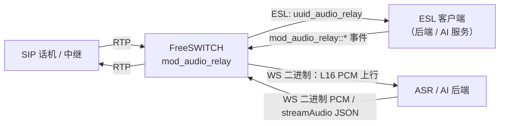

<p align="right">
  <a href="README.md">English</a> | <a href="README_ZH.md">简体中文</a>
</p>

<h1 align="center">mod_audio_relay</h1>

<p align="center">
  <strong>FreeSWITCH 音频 WebSocket 中继模块 —— Rust 自研实现</strong>
</p>

<p align="center">
  <a href="https://www.rust-lang.org"></a>
  <a href="LICENSE"></a>
  <a href="https://github.com/tangyu-dch/mod_audio_relay"></a>
</p>

---

**mod_audio_relay** 将 FreeSWITCH 通话的双向音频桥接到远端
**WebSocket** 端点，使实时 ASR、TTS 注入、通话录音流水线和 AI 语音
Agent 成为可能——且完全不触碰 SIP 信令路径。

> [!NOTE]
> 本模块为**自研** Rust 实现。对外命名为 `mod_audio_relay` /
> `uuid_audio_relay` / `mod_audio_relay::*`；与 C 参考实现仅在行为层面
> 对齐，并非源码级兼容。

---

## 📋 目录

- [特性](#-特性)
- [架构](#-架构)
- [快速开始](#-快速开始)
- [API 参考](#-api-参考)
- [文档](#-文档)
- [已知限制](#-已知限制)
- [测试](#-测试)
- [许可证](#-许可证)

---

## ✨ 特性

### 🔊 双向音频桥接
- **上行**：通话音频 → L16 PCM s16le WebSocket 二进制帧，采样率可配置
  （8–64 kHz）。
- **下行**：两条路径——裸 PCM 二进制帧，或 `streamAudio` JSON 消息
  （支持 `raw` PCM 及 `wav`/`mp3`/`ogg`/`pcmu`/`pcma`/`opus` 编码格式，
  经 FreeSWITCH 自身编解码栈解码）。
- **播放队列**：约 2 s 环形缓冲，代际保护的 `interrupt` /
  `stop_playback`；溢出丢最旧数据。

### 🧩 FreeSWITCH 集成
- 单一 API 动词 `uuid_audio_relay`：`start` / `stop` / `status` /
  `interrupt` / `stop_playback`。
- 自定义 ESL 事件命名空间 `mod_audio_relay::*`：生命周期、JSON 透传、
  播放结果与错误。
- 按通道 `STREAM_*` 变量控制 TLS、请求头、deflate 与上行包聚合。

### 🛠 工程结构
- Workspace 拆分：`audio-relay-core`（协议无关——WebSocket、PCM、
  重采样、队列）+ `mod-audio-relay`（fswtch FreeSWITCH 胶水层）。
  **core 中零 FreeSWITCH 概念。**
- rustls TLS（系统信任库或 `STREAM_TLS_CA_FILE`）、可选双向 TLS、自定义
  握手头、permessage-deflate 控制。
- `bug.rs` 中的媒体 bug trampoline 规避了 fswtch
  `attach_media_bug` 的回调缺口。

---

## 🏛 架构

```
┌──────────────────────┐         WebSocket（二进制 PCM ↑ / JSON+PCM ↓）
│   ASR / TTS / AI     │ ◄──────────────────────────────────────────┐
│   后端服务            │                                            │
└──────────────────────┘                                            │
        ▲ ESL 命令 + mod_audio_relay::* 事件                          │
        │                                                            │
┌───────┴────────────────────────────────────────────────────────────┴─┐
│  FreeSWITCH                                                           │
│   ┌───────────────┐   media bug    ┌───────────────────────────────┐  │
│   │  SIP / RTP    │ ─────────────► │   mod_audio_relay (Rust cdylib)│  │
│   │  通话腿        │                │  bug.rs → 捕获/播放            │  │
│   └───────────────┘                │  transport.rs → WS 客户端      │  │
│                                    └───────────────────────────────┘  │
└──────────────────────────────────────────────────────────────────────┘
```



---

## 🚀 快速开始

### 前置依赖

| 依赖 | 版本 | 说明 |
| --- | --- | --- |
| Rust 工具链 | stable | `cargo build` |
| `libclang` | 任意较新版本 | 构建期 fswtch-sys bindgen |
| `libspeexdsp` | pkg-config 可见 | 模块内重采样 |
| FreeSWITCH | 1.10+ | 头文件经 `${FS_PREFIX}` 解析 |

### 构建

```bash
git clone https://github.com/tangyu-dch/mod_audio_relay.git
cd mod_audio_relay

cargo build --release -p mod-audio-relay
# → target/release/libmod_audio_relay.so

cargo test --workspace   # 104 项单元测试
```

### 安装与验证

```bash
cp target/release/libmod_audio_relay.so ${FS_PREFIX}/mod/
# 在 autoload_configs/modules.conf.xml 中添加
# <load module="mod_audio_relay"/>
# 重启 FreeSWITCH，然后：
./scripts/verify-deployment.sh
```

完整部署流程、实呼验证与部署清单见
**[docs/zh/DEPLOYMENT.md](docs/zh/DEPLOYMENT.md)**。

---

## 🔌 API 参考

```
uuid_audio_relay <uuid> start <ws_url> [metadata] [sampling] [mono|mixed|stereo]
uuid_audio_relay <uuid> stop
uuid_audio_relay <uuid> status
uuid_audio_relay <uuid> interrupt
uuid_audio_relay <uuid> stop_playback
```

| 参数 | 取值 | 默认值 |
| --- | --- | --- |
| `ws_url` | `ws://` / `wss://` 端点 | 必填 |
| `metadata` | 首条文本帧（含空格需加引号） | 无 |
| `sampling` | 8000–64000，8 kHz 步进（支持 `16k`） | 8000 |
| `mix_mode` | `mono` / `mixed` / `stereo` | `mono` |

事件：`mod_audio_relay::start` / `::stop` / `::json` / `::play` /
`::error`。完整命令语义与生命周期示例见
**[docs/zh/ESL_GUIDE.md](docs/zh/ESL_GUIDE.md)**。

---

## 📚 文档

| 文档 | 内容 |
| --- | --- |
| [docs/zh/DEPLOYMENT.md](docs/zh/DEPLOYMENT.md) | 构建、安装、验证、部署清单、故障排查 |
| [docs/zh/ESL_GUIDE.md](docs/zh/ESL_GUIDE.md) | API 命令、事件、时序规则、常见故障 |
| [docs/zh/PROTOCOL.md](docs/zh/PROTOCOL.md) | WebSocket 生命周期、字节级 PCM 规范、`streamAudio` |
| [docs/en/](docs/en/) | English versions of the above |
| [README.md](README.md) | English README |

---

## ⚠️ 已知限制

| 限制 | 状态 | 规避方式 |
| --- | --- | --- |
| fswtch `attach_media_bug` 不触发 READ/WRITE_STREAM 回调 | 已通过 `bug.rs` trampoline 解决 | 无需处理 |
| 捕获依赖会话读路径（`switch_core_session_read_frame`）；`park()` 等不读帧状态无上行 | FreeSWITCH 固有行为 | 仅在 ANSWERED/BRIDGED 后 start；保留读者应用 |
| codec 相同的 RTP-proxy 桥接绕过 `read_frame` | FreeSWITCH 固有行为 | 强制转码或保留读者；下行不受影响 |

详见 [docs/zh/DEPLOYMENT.md](docs/zh/DEPLOYMENT.md#已知限制)。

---

## 🧪 测试

```bash
cargo test --workspace
```

104 项单元测试，覆盖协议无关核心（分帧、重采样、队列、传输、URL/TLS
解析）与 fswtch 胶水层（参数解析、标志位、字符串转换）。
`separate_args` 要求含空格的 metadata 必须加引号——见 ESL 指南。

`scripts/verify-deployment.sh` 在真实 FreeSWITCH 主机上执行部署后验证
（支持 `FS_CLI`/`FS_PREFIX` 环境变量覆盖）。

---

## 📄 许可证

[AGPL-3.0](LICENSE)——全文见 [LICENSE](LICENSE)。
